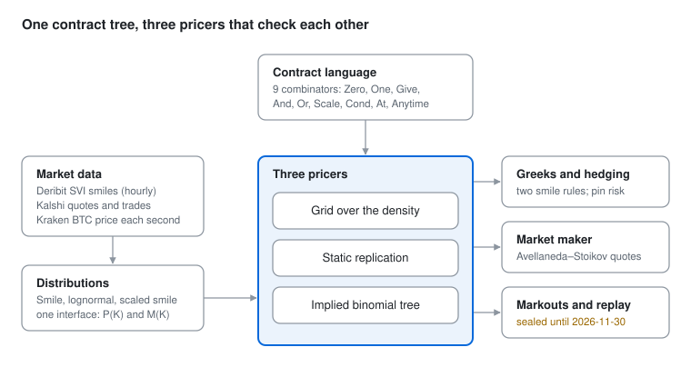

# ocaml-contracts

A financial contract language in OCaml that prices Kalshi's Bitcoin prediction markets from the probability distributions implied by Deribit's Bitcoin options. It's built on Peyton Jones, Eber and Seward's *Composing contracts* (ICFP 2000). Every contract is a tree of nine combinators, and three independent pricers value it, each checking the others. On top of that sit Greeks and hedging, an Avellaneda–Stoikov market maker for $0/$1 contracts, and a markout system that measures how informed real order flow is.



## A taste of the language

A contract is data, so instruments are definitions rather than pricing code:

```ocaml
(* At expiry, take the better of receiving S - K or nothing. *)
let call ~expiry ~strike = at expiry (or_ (scale (spot_minus strike) one) zero)

(* Kalshi's "BTC above K at the close": $1 or nothing. *)
let above ~expiry ~strike = at expiry (cond (Pred.Ge (Spot, Const strike)) one zero)

(* "Will BTC touch B before expiry?", from existing combinators: lock in $1 the moment the price is at B. *)
let one_touch_above ~expiry ~barrier =
  anytime expiry (cond (Pred.Ge (Spot, Const barrier)) (at expiry one) zero)
```

The same tree is read by several interpreters: a printer (`to_english`), a date checker, a piecewise-linear payoff compiler, a simplifier that rewrites by the language's algebraic laws, and the three pricers.

```
$ dune exec bin/main.exe
Toy BTC ladder, 1 day out, spot $100,000, vol 55%

Each bucket is a contract like:
  at day 1: if Spot >= 103000 then receive $1 else nothing

  below 97000           14.8 c
  97000 to 98000         9.7 c
  ...
  103000 or above       15.0 c
```

## Three pricers that check each other

| Pricer | Method | What it adds |
| --- | --- | --- |
| `Pricer` | integrate the payoff over a discretised density | general |
| `Replication` | Carr–Madan static replication from the digital curve P(K) and partial mean M(K) | exact for digitals |
| `Lattice` | Rubinstein (1994) implied binomial tree | time: American options, touch contracts |

Every pricer returns `Ok price` or a typed `Error` (a date past the model's horizon, a date already passed, a path-dependent contract on a one-date model), never a made-up number.

## Validation

| Check | Result |
| --- | --- |
| Reference probabilities from a separate Python implementation, 13,804 Kalshi contracts | matched to 2.7 × 10⁻¹² |
| Grid vs replication vs tree on random contracts (Quickcheck) | agree to rounding |
| Greeks by bump-and-reprice vs Black's closed forms | about 10⁻⁴, the bump's own error |
| Merton: American call = European (no dividends); American put > European at a 4% rate | 3,072.54 = 3,072.54; 2,999.88 > 2,995.85 |
| Discrete barrier vs Broadie–Glasserman–Kou corrected closed form | within 0.002 at 200 and 800 steps |
| Delta-hedging on the tree, re-hedged every step | worst error 7 × 10⁻¹⁴ over 4,000 paths |
| Fair value from moved hourly smiles vs Black's N(d₂) | 4 × 10⁻⁶ |

## Market making, in simulation

The quoting rule is Avellaneda–Stoikov adapted to a $0/$1 payout. Quotes lean against inventory, the spread trades fill rate against edge, and an extra term widens quotes when the fair value is about to jump. All results below are on synthetic order flow.

| Experiment | Result |
| --- | --- |
| Uninformed flow: P&L equals edge captured (a known-answer check) | gap −0.020 ± 0.024 |
| Cost of informed flow as its arrival rate doubles | 0.42, 0.84, 1.70 per day |
| P&L volatility, ignoring inventory vs leaning on it vs delta-hedging | 2.26 vs 0.26 vs 0.25 |
| Traders who see 10 steps ahead | every spread loses; not quoting wins (Glosten–Milgrom) |
| A sold digital, re-hedged every 4 steps | 13 cents of risk left, concentrated near the strike (pin risk) |

## Measuring real order flow

A markout marks each trade's passive side against options-implied fair value seconds and minutes later. If takers know nothing, it stays at the half-spread. If they see where BTC is going, it falls. On a synthetic market with nine in ten takers seeing a minute ahead, the 60-second markout is −0.97 cents, with its 95% interval below zero. Uninformed takers leave it flat at +2.00. Real Kalshi trades and per-second BTC prices are backfilled weekly by a companion research project.

Comparing Kalshi's real prices with the options is a pre-registered test in that project, sealed until 2026-11-30. The `Seal` module holds its window, and the analysis tools refuse to run inside it. Until then, every tool that touches real data either prices from the options alone or only counts rows.

## Try it

Needs OCaml 5.1+ and opam.

```bash
opam install . --deps-only
dune build
dune runtest                       # 80 expect and property tests; silence means they pass
dune exec bin/main.exe             # price a toy ladder
dune exec exercises/simplify/check.exe   # the simplifier against its 17 examples and 4 properties
```

The other tools in `bin/` (Greeks, structures, touch probabilities, the market maker on real smiles, markouts) read data exported by the companion research project, which isn't public.

## Map of the code

| Module | Role |
| --- | --- |
| `contract`, `instruments`, `kalshi` | the language, standard instruments, Kalshi's markets |
| `pricer`, `payoff`, `replication`, `lattice` | the three pricers and the payoff compiler |
| `unpriceable` | the typed date rules all pricers share |
| `smile`, `density`, `model_choice` | SVI smiles, densities, swappable distributions |
| `greeks`, `hedge` | sensitivities under two smile rules; hedging simulation |
| `market_maker`, `markout`, `replay` | quoting, simulated markets, markouts, replay against a real book |
| `simplify` | algebraic rewriting, checked for soundness by property tests |
| `export`, `hf`, `seal` | data loading, and the dates before which comparisons may not run |

`WALKTHROUGH.md` explains every stage in prose: what changed, why, and what each test proves.

## References

Peyton Jones, Eber and Seward (2000), *Composing contracts* · Breeden and Litzenberger (1978) · Carr and Madan, static replication · Gatheral and Jacquier (2014), SVI · Rubinstein (1994), *Implied binomial trees* · Broadie, Glasserman and Kou (1997) · Avellaneda and Stoikov (2008) · Glosten and Milgrom (1985).

## Author

Tave La Rocque, Integrated Engineering, University of British Columbia. Developed with an AI pair programmer (Claude); design, direction and review by the author.

## About this repository

This is a public snapshot of a private working repository, published with `tools/publish_public.sh` (from commit
f6b1547). History starts fresh here, and the Kalshi quotes in `test/data/contracts_sample.csv` are blank: they fall
inside the window of a pre-registered test in the companion research project, Implied Odds, which is sealed until
2026-11-30. The tests use only that file's strikes, smiles and reference probabilities, so they run unchanged.
